


 

## 👋 Sobre mí


Ingeniero Agrónomo de la **Universidad Nacional de Colombia** y estudiante de la **Maestría en Geomática**. Trabajo en el punto donde se cruzan la agronomía de campo, la teledetección y la inteligencia artificial: tomo datos del lote —fotos, drones, satélites, estaciones climáticas— y los convierto en herramientas que ayudan a decidir.

- 🌽 **Project Researcher** en la alianza **UNAL – Purdue University**: plataforma para monitorear y predecir enfermedades foliares del maíz (mancha de asfalto, *Phyllachora maydis*).
- 🤖 Entreno **modelos de lenguaje pequeños** que corren dentro del teléfono para dar recomendaciones fitosanitarias en español e inglés.
- 🛰️ Construyo **plugins de QGIS** para fenología con procesos gaussianos, predicción espacial con GPBoost e interferometría radar (InSAR).
- 🔬 Visión por computador para **fitopatología** (YOLOv11, CNNs) y fenotipado con **UAV multiespectral**.
- 📱 Desarrollo apps **Flutter** y **Android nativo** pensadas para funcionar sin conexión en campo.

 

## 🧪 Proyectos destacados


<a href="https://github.com/jf-floresriera/GEE_GPR_Phenology"></a>

<a href="https://github.com/jf-floresriera/pea_drone"></a>
<a href="https://github.com/jf-floresriera/powderyvision7"></a>

<a href="https://github.com/jf-floresriera/GPBoost-Spatial-Predictor"></a>
<a href="https://github.com/jf-floresriera/hevea-agroclima-salb-clf"></a>

<a href="https://github.com/jf-floresriera/SAR-and-Optical-Multisensor-Interpretation-Guide"></a>

<a href="https://github.com/jf-floresriera/Reto7"></a>
<a href="https://github.com/jf-floresriera/zenodo-resume-downloader"></a>

🔒 Los proyectos privados se muestran sin código ni datos: solo el alcance técnico.

<b>📂 Más repositorios públicos</b>

 

| Área | Repositorios |
|---|---|
| 🌽 Fenología y GPR | [proyecto_final_programacion_sig](https://github.com/jf-floresriera/proyecto_final_programacion_sig) · [sentinel2-maize-gaussian-processes](https://github.com/jf-floresriera/sentinel2-maize-gaussian-processes) · [project_remote_sensing](https://github.com/jf-floresriera/project_remote_sensing) |
| 🛰️ Radar | [umbra_SAR_data_explore](https://github.com/jf-floresriera/umbra_SAR_data_explore) · [SAR-and-Optical-Multisensor-Interpretation-Guide](https://github.com/jf-floresriera/SAR-and-Optical-Multisensor-Interpretation-Guide) |
| 🤖 IA agropecuaria | [Proyecto final IA y producción agropecuaria](https://github.com/jf-floresriera/Inteligencia-artificial-y-modelos-de-produccion-agropecuaria_-PROYECTO-FINAL) · [Powdery_Mildew_App_Xception_vFinal](https://github.com/jf-floresriera/Powdery_Mildew_App_Xception_vFinal) · [gulupascaner](https://github.com/jf-floresriera/gulupascaner) |
| 🗺️ Programación SIG (Python · R · Julia) | [taller1-sig](https://github.com/jf-floresriera/taller1-sig) · [fundamentos_raster-](https://github.com/jf-floresriera/fundamentos_raster-) · [operaciones_raster](https://github.com/jf-floresriera/operaciones_raster) · [replicacion_multidimensional](https://github.com/jf-floresriera/replicacion_multidimensional) · [tarea_Vectorizacion_DataFrames](https://github.com/jf-floresriera/tarea_Vectorizacion_DataFrames) · [tarea-io-limpieza-datos](https://github.com/jf-floresriera/tarea-io-limpieza-datos) · [Arcpy_retos_aprendizaje_autonomo](https://github.com/jf-floresriera/Arcpy_retos_aprendizaje_autonomo) · [Personalizar_QGIS_Python](https://github.com/jf-floresriera/Personalizar_QGIS_Python) |
| 📱 Móviles | [227_APP](https://github.com/jf-floresriera/227_APP) · [flutter_demo](https://github.com/jf-floresriera/flutter_demo) · [app_dadm_personalizado](https://github.com/jf-floresriera/app_dadm_personalizado) · [reto_0](https://github.com/jf-floresriera/reto_0) · [Reto_3](https://github.com/jf-floresriera/Reto_3) · [Reto_4](https://github.com/jf-floresriera/Reto_4) · [RETO_5](https://github.com/jf-floresriera/RETO_5) · [Reto6](https://github.com/jf-floresriera/Reto6) · [Reto7](https://github.com/jf-floresriera/Reto7) · [Reto8](https://github.com/jf-floresriera/Reto8) · [Reto9](https://github.com/jf-floresriera/Reto9) |
| 🌐 Web y Python | [agrocost](https://github.com/jf-floresriera/agrocost) · [3 (portal Flask)](https://github.com/jf-floresriera/3) · [gdp-dashboard](https://github.com/jf-floresriera/gdp-dashboard) · Python básico: [5](https://github.com/jf-floresriera/5-Variables-y-tipos-de-datos) · [6](https://github.com/jf-floresriera/6-_Estructuras-de-datos) · [7](https://github.com/jf-floresriera/7-Operaciones-con-Cadenas-de-Texto-Strings-) · [8](https://github.com/jf-floresriera/8-Bucles-y-Declaraciones-Condicionales) · [9](https://github.com/jf-floresriera/9-Funciones-y-Clases-El-camino-a-la-Modularizaci-n) · [10](https://github.com/jf-floresriera/10-Trabajando-con-Archivos) |

## 🛠️ Stack tecnológico

**Lenguajes**


**IA y ciencia de datos**


**Geoespacial y teledetección**


**Backend, móvil y DevOps**


## 🧠 Destrezas extraídas de mi código

Lo que sigue sale de revisar mis repositorios públicos y privados, no de una lista de deseos.

<b>🛰️ Teledetección y SIG</b>

- **Google Earth Engine** en JavaScript y Python (`ee`, `geemap`): Sentinel-2, MODIS, CHIRPS, AgERA5 e IMERG.
- **Gaussian Process Regression** para recuperar LAI/variables biofísicas, rellenar huecos temporales y extraer fenología con doble logística (LSP).
- **Radar**: generación de grafos XML para ESA SNAP (cadena TOPS, interferograma, coherencia, desenrollado), redes de pares **SBAS**, *phase linking*, búsqueda en ASF, CDSE y Planetary Computer; Sentinel-1, ALOS-2 y metadatos Umbra en S3.
- **UAV multiespectral**: calibración radiométrica, grillas de parcelas, estadística zonal e ingesta de ortomosaicos y fotogrametría.
- Raster y vector con **rasterio, GDAL, xarray/rioxarray, geopandas, shapely, pyproj, cartopy**; benchmarks equivalentes en **R** (`terra`, `stars`) y **Julia** (`ArchGDAL`, `Rasters.jl`).
- **Plugins de QGIS** completos: *Processing provider*, diálogos, i18n e instalador de dependencias; automatización con **ArcPy**.

<b>🤖 IA, visión y modelos</b>

- **YOLOv11** (clasificación y segmentación) y CNNs con *transfer learning* (Xception, MobileNet, ResNet) para severidad de enfermedades; post-procesamiento con OpenCV y scikit-image.
- **LLMs**: minería de corpus científico abierto, limpieza de PDF/HTML (PyMuPDF, trafilatura), detección de idioma, deduplicación MinHash, adaptación de dominio (DAPT) y ajuste fino SFT con **Transformers + PEFT + TRL**, **QLoRA** con bitsandbytes, evaluación por perplejidad y benchmarks, y cuantización **GGUF** para móviles.
- Modelado tabular: **LASSO, Random Forest, XGBoost, PLS**; validación cruzada por grupos (`GroupKFold`, `LeaveOneGroupOut`); modelos mixtos con **statsmodels** para heredabilidad y G×E.
- **GPBoost**: árboles + procesos gaussianos para predicción espacial con efectos aleatorios.

<b>⚙️ Backend y datos</b>

- APIs asíncronas con **FastAPI + SQLAlchemy 2 (async) + asyncpg**, esquemas **Pydantic**, autenticación JWT y bcrypt.
- **PostGIS** con GeoAlchemy2 y migraciones versionadas con **Alembic**.
- Almacenamiento de objetos **S3/MinIO**, rásters **COG** y teselas dinámicas con **TiTiler**; lectura por ventanas desde catálogos **STAC**.
- Analítica columnar con **DuckDB + PyArrow**; datos climáticos de **ERA5** y **NASA POWER**.
- Control de calidad de observaciones (válida / dudosa / descartada, nunca se borra) y motor de decisiones por reglas, trazable.
- Pruebas automatizadas con **pytest** y **pytest-asyncio**.

<b>📱 Móvil</b>

- **Flutter offline-first**: Riverpod, base local Drift/SQLite, go_router, Dio/Retrofit, flutter_map, GPS, captura de foto y audio, localización (l10n), freezed y json_serializable.
- **Android nativo** en Kotlin y Java: *Custom Views* con Canvas, sonidos, menús y diálogos, arquitectura **MVVM + Clean Architecture**, multijugador en tiempo real con **Firebase Realtime Database**, persistencia **SQLite**, mapas con **OSMDroid + Overpass API**.

<b>🔐 Seguridad, despliegue y DevOps</b>

- **Supabase**: PostgreSQL con *Row Level Security*, cifrado con `pgcrypto`, *Edge Functions* en Deno/TypeScript, verificación por código enviado al correo; sitio estático en **Cloudflare Pages**.
- Pruebas de carga con **k6** (escenarios por etapas y umbrales de latencia p95).
- **Docker Compose** multiservicio, Makefile, scripts Bash/PowerShell, **WSL2**, **GitHub Actions** para compilar APK.
- Descargas robustas: rangos HTTP en paralelo, reintentos con espera exponencial, reanudación y verificación MD5.
- Reportes reproducibles con **Quarto** (HTML/PDF) y documentación bilingüe.

## 📊 En números



Calculado sobre el código de mis 53 repositorios (públicos y privados), sin contar datos, archivos generados ni duplicados · octubre 2026

## 💼 Experiencia

| Rol | Dónde | Periodo |
|---|---|---|
| **Project Researcher** — Alianza UNAL – Purdue University | Bogotá, Colombia | Ene 2026 – actualidad |
| **Research Intern** — Agrocomputation & Epidemiological Analysis Lab | Facultad de Ciencias Agrarias, UNAL | Jun 2025 – Ene 2026 |
| **Teaching Assistant** — Ciencia del Suelo y Manejo Integrado de Enfermedades | UNAL, Bogotá | Durante el pregrado |

**Logros clave**
- **PowderyVision** (Flask) con CNNs (ResNet101, ConvNeXt, Xception) y YOLOv11 cls/seg — 99 % de precisión.
- **XGBoost** para análisis espectral de calidad (98 % de precisión) y medición de huella de carbono con **CodeCarbon**.
- Pipelines **PSPNet/ResNet34** sobre más de 140 000 imágenes de campo capturadas por robots Solinftec (alianza con Purdue).
- Apps **R Shiny** y **Gradio** para monitoreo de campo; datasets **FAIR** publicados en Hugging Face.

## 🎓 Educación

- **M.Sc. en Geomática** — Universidad Nacional de Colombia · Ene 2026 – presente
- **B.Sc. en Ingeniería Agronómica** — Universidad Nacional de Colombia · Ago 2020 – Dic 2025 · Top 4 % nacional en Saber Pro · Trabajo de grado 4.4/5

<b>📜 Certificaciones seleccionadas</b>

- Python para Ciencia de Datos — Pontificia Universidad Católica de Chile (2025)
- Intelligent Automation in Biological Systems — UNAL, 64 h (2024)
- Agricultural Soil Conservation — Ministerio de Agricultura / UPRA / Agronet (2024)
- Extraction with Supercritical Fluids: Theory and Applications — UNAL, 64 h (2023)
- Agricultural Production Systems and Sustainability — Universidad de Almería, España (2023)
- Mecanización agrícola (cosechadoras, fumigación, siembra, tractores) — Fundación Fomenta / AmCham (2023)
- Plant Nutrition and Fertigation — UNAL & Universidad de Almería (2022)

## 📫 Contacto

📍 Bogotá, Colombia &nbsp;·&nbsp; ✉️ [jesusenriqueflores36@gmail.com](mailto:jesusenriqueflores36@gmail.com) &nbsp;·&nbsp; 🏛️ [jfloresr@unal.edu.co](mailto:jfloresr@unal.edu.co)

